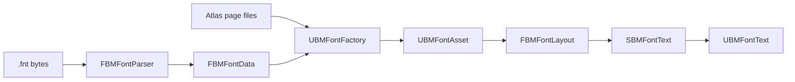

# Architecture

[简体中文](Architecture.zh-CN.md)

Unreal BMFont uses a narrow pipeline so each responsibility can be tested without a UMG scene.

## Modules

### UnrealBMFont (Runtime)

- Owns serializable data structures and `UBMFontAsset`.
- Parses descriptors without any Editor dependency.
- Converts a Unicode string into positioned bitmap glyphs.
- Paints glyph UV rectangles through Slate brushes.
- Exposes the UMG `UBMFontText` wrapper.

### UnrealBMFontEditor (Editor)

- Registers the modern Asset Definition.
- Imports `.fnt` descriptors and their page textures.
- Tracks source data and implements reimport.
- Draws Content Browser thumbnails and the read-only font/atlas inspector opened on double-click.
- The inspector composites the coverage channels used by packed glyphs on the selected page; overlapping channels share the atlas view. Preview brushes are cached until the page, font data, or render resources change.
- Contains importer-specific automation coverage.

### UnrealBMFontTests (Editor)

- Tests parser and layout behavior through public Runtime APIs.
- Is an Editor module, so it cannot enter game targets or packaged builds.

## Data ownership

`UBMFontAsset` owns descriptor metadata and hard references to imported page textures. It also maintains a non-serialized kerning lookup, metric/resource revisions and a native change notification. Reimport replaces the serializable model, rebuilds the lookup and explicitly invalidates subscribed widget layouts, including cached trees that would not otherwise paint. Material recovery advances a separate resource revision and invalidates paint without redoing glyph metrics. See [API.md](API.md) for ownership, mutation and serialized-schema contracts.

## Layout model

Layout decodes Unicode scalar values, resolves fallback glyphs, applies pair kerning and tracking, uses Unreal's line-break iterator, and produces positioned quads. The wrapping scan is linear per paragraph. It deliberately does not invoke Unreal's font shaping pipeline because the source data contains bitmap rectangles rather than a font face.

## Rendering model

`SBMFontText` is an `SLeafWidget`. Layout is cached by text, font data revision, settings, and resolved wrapping width. Its brush cache is keyed by layout revision and contains only the distinct glyphs used by that layout, so changing a short string in a large CJK asset does not rebuild brushes for the entire font. `OnPaint` still performs a constant-time revision check before using the cache. All glyphs on the same texture/layer remain eligible for Slate batching.

Packed-channel glyphs render through `UMaterialInstanceDynamic` resources created from the asset's packed render material (default: the plugin's `M_BMFontPacked`). The base material is resolved when packed data is assigned, loaded, or edited rather than during the normal first paint. If that lifecycle load is temporarily unavailable, the first render-resource request retries once. Unresolved assets then check only the already-loaded soft object at 4 Hz, without IO; recovery stops polling, advances the resource revision and queues a non-reentrant paint notification. Failed loads cannot trigger synchronous loading once per glyph or paint. The asset caches material instances by page ID and glyph channel mask. Each instance receives the page texture and channel mapping computed from `char.chnl` plus the common channel metadata, while Slate's vertex color continues to apply tint and shadow. Non-packed pages keep the plain texture path.

## Text model

The core accepts plain text and maps each code point through the BMFont layout and paint primitives. Rich Text markup lives in an optional adapter: `UBMFontRichTextBlock` contributes a Slate decorator that converts matching runs into BMFont runs measured and painted with the same glyph metrics. Each rich-text run is laid out independently, so kerning does not cross run boundaries. Run-local brushes are created only for glyphs the run uses and are retained until the asset revision changes.
