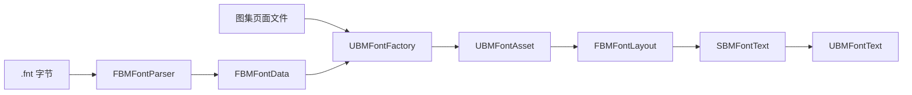

# 架构

[English](Architecture.md)

Unreal BMFont 使用职责明确的精简管线，每部分都能脱离 UMG 场景进行测试。

## 模块

### UnrealBMFont（Runtime）

- 持有可序列化的数据结构和 `UBMFontAsset`。
- 解析描述文件，不依赖 Editor 模块。
- 将 Unicode 字符串转换为已定位的位图字形。
- 通过 Slate 画刷绘制字形 UV 矩形。
- 提供 UMG 包装控件 `UBMFontText`。

### UnrealBMFontEditor（Editor）

- 注册现代 Asset Definition。
- 导入 `.fnt` 描述文件及其页面纹理。
- 跟踪源数据并实现重导入。
- 绘制 Content Browser 缩略图，并提供双击打开的只读字体、图集检查器。
- 检查器合成当前页面中 packed 字形使用的覆盖率通道；重叠通道显示在同一图集视图中。预览画刷缓存到页面、字体数据或渲染资源变化时才更新。
- 包含导入器专用的自动化测试。

### UnrealBMFontTests（Editor）

- 通过公开 Runtime API 测试解析和布局行为。
- 作为 Editor 模块，不进入游戏目标或打包构建。

## 数据所有权

`UBMFontAsset` 持有描述元数据，以及导入页面纹理的硬引用。它还维护不序列化的 kerning 查询表、度量与资源版本，以及原生变更通知。重导入替换可序列化模型、重建查询表，并显式使订阅控件的布局失效，包括原本不会重新绘制的缓存控件树。材质恢复推进独立的资源版本，只使绘制失效，不重新计算字形度量。所有权、修改方式和序列化约定见[公开 API](API.zh-CN.md)。

## 布局模型

布局解码 Unicode 标量值、解析缺字回退、应用字偶距（kerning）和字间距（tracking），并使用 Unreal 的断行迭代器生成定位后的四边形。每个段落的换行扫描是线性的。源数据提供的是位图矩形，而不是字体面，因此不调用 Unreal 的字体塑形管线。

## 渲染模型

`SBMFontText` 是 `SLeafWidget`。布局按文本、字体数据版本、设置和最终换行宽度缓存。画刷缓存以布局版本为键，只包含该布局实际使用的不同字形，因此大型 CJK 字体中的短文本变化不会为整张字形表重建画刷。`OnPaint` 在使用缓存之前仍进行常量时间的版本检查。同一纹理、同一层上的字形仍可参与 Slate 批处理。

Packed-channel 字形使用从资产 packed 渲染材质创建的 `UMaterialInstanceDynamic` 资源，默认材质是插件内的 `M_BMFontPacked`。基础材质在 packed 数据赋值、加载或编辑时解析，不在正常首次绘制时加载。生命周期加载暂时失败时，首次渲染资源请求会重试一次。之后，未解析成功的资产只以 4 Hz 查询已经加载的软引用对象，不执行 IO；恢复后停止轮询、推进资源版本，并排队发送非重入的绘制通知。失败加载不会导致每个字形或每次绘制都同步加载。资产按页面 ID 和字形通道掩码缓存材质实例。每个实例接收页面纹理，以及根据 `char.chnl` 和公共通道元数据计算的通道映射；Slate 顶点颜色继续应用染色和阴影。非 packed 页面仍走普通纹理路径。

## 文本模型

核心接受普通文本，把每个码点映射到 BMFont 布局和绘制原语。Rich Text 标记位于可选适配器中：`UBMFontRichTextBlock` 提供 Slate decorator，把匹配的 run 转换为 BMFont run，使用相同字形度量进行测量和绘制。每个 Rich Text run 独立布局，因此 kerning 不跨 run 边界。run 内的画刷只为它实际使用的字形创建，并保留到资产版本变化。
